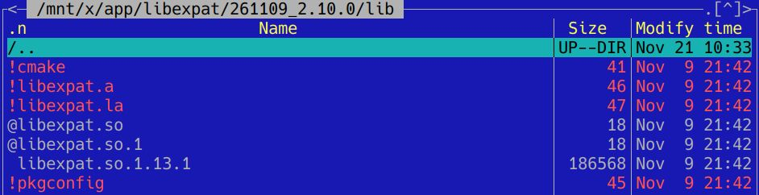
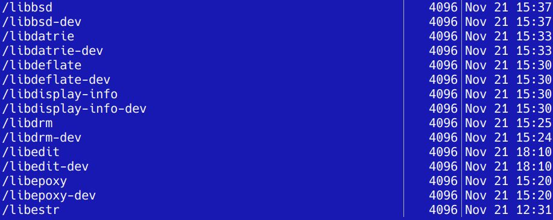
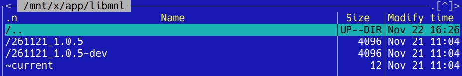

[Prev page](file_ym_milestone14.md) [Next page](file_zz_milestone.md)

# Milestone 15

# One step back, two forward

Creating OS looks very hard, right?

Let's look on some issues (I don't name them problems, because these are things, which CAN be resolved and WILL be resolved). They're not mentioned to show, how difficult things are.
This is rather Postmortem documention done after some tries and finding some conclusions (which is natural part of the process)

**Programmer crap**

First of all - are typical users programmers or just people, who want to run apps? Why we see quite always so many include and other dev files in Linux? What disk profits
we will get when remove some of files?

Some candidates to deleting:

* all a files (static libraries)
* documentation including man3 files
* some package related files like cmake info or pc files

Static libraries could be used in rare cases and PLLinux will probably deliver them only for packages used for static compiling basic binaries (main rule is, that shared files will
be used everywhere). The other mentioned things are many times (not always) small and creating separate directories with them can need actually MORE place on disk than saving them
with "main" package.

Some statistics: /app directory in my PLLinux needs 2 224 128 kB, in the same time directories with majority of "dev" packages 110 280 kB.

It's not too much, additionally splitting files will need extra work and can make some complications in the future. This topic needs to be still further analysed. Possible options:

1. delivering all packages in "main+dev" or "main" form
2. delivering separate "dev" packages only, when they're bigger for example than 40KB
3. delivering all packages in "main+dev" form only

And how should look these "dev" packages? Should we link all files from "main" to "dev"?

It doesn't look ellegant and easy and suggests some problems, when "dev" package is not installed as well.

Should we have dev files in separate files? The profit is, that admin will see immediately, what is installed and what not (but in the same time it's not clearly visible, if we have all "main" and all "dev" in the same version)

Maybe in that case we should give everything with same package name and just add "-dev" to the version?

This gives profit, that removing app is deleting everything at once... but admin needs to enter package directory to see everything.

Like I written, this thing will be still investigated. Probably option with "main+dev" or "dev" version is the best. But we will see in the future.

**Current and non-current versions**

The goal in PLLinux is, that you can assign to some users "current" version of apps and they can be replaced on fly (user will just need to restart app). This could work, when... app files don't have hardcoded real paths. In current build it doesn't always happend and readme.md for such apps contains new element:

    **Current**
    yes

This needs to be improved with future releases. The goal is to have all system config in /etc (or other kernel releated directories) and user config in /home/app.

**Crappy and obsolete code**

/bin/sh from previous milestone is just example of this what is happening. Programmers for years assumed some behaviors and didn't respect standards. To improve it we need projects like PLLinux - currently some files and settings in packages are still unknown, but it's improving from release to release.

**Users with and without sandboxing**

One of main goals was, that user has got nice filesystem. Before today it was implemented, that:

1. root files are saved in /home (please don't comment, there were various reasons for it)
2. user files are saved in /etc/users (it contains symlink from /etc/users/root into /home too)
3. users after logging into sandbox see their home directory inside /home (we map /etc/users/(user_name))
4. root after logging see its home directory inside /home

But what when users want to more classical design and be able to use sudo/su? We can't sandbox them (with this version security will be much lower) & we need, that /home contains classic files (/home/user1, /home/user2, etc.).

After some consideration new approach will be probably, that:

1. we will have "classic" /home directory (/home/user1, /home/user2, etc.)
2. root home files will be saved inside /home/root (with few users it shouldn't be big problem)
3. for sandboxed user we will mount /home/(user) into /home

Root and non-sandboxed user will see all users inside /home & there is risk, that some software will save something inside /home. Not nice, but how to resolve it in nice way? One step back, two forward. I hope to find better solution in the future.

**Cascade linking for libraries?**

Let's assume, that we have app1 using few other apps (app2, app3, etc.). Currently all deps from app2 and app3 need to be mentioned in the app1, it will be probably changed to cascade linking - app1 will link only app2, app3, etc. and system will check their readme.md for next deps. This approach has got disadvantage (they can potentially add dep to something, we don't want), but greatly improve situation, when we remove some deps from them.

**Should we support all font types?**

BDF, TTF, PSF and others. Should system distribute all or just subset? (for now we use PSF for console and TTF for X11)

**Going with all standards?**

Wayland or X11 or both? Or maybe systemctl?

These questions are with me the whole time and (as for now): 

1. Wayland implementations are more complicated or not working (the only one sensible
till now seems to be Weston, but it doesn't have real taskbar, which is very bad, because 99% is done)
2. systemctl is maybe used by part of Linux world, but this is really not working well, when you want to separate things

[Prev page](file_ym_milestone14.md) [Next page](file_zz_milestone.md)
